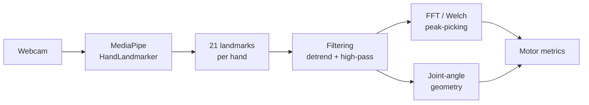
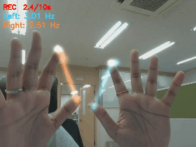
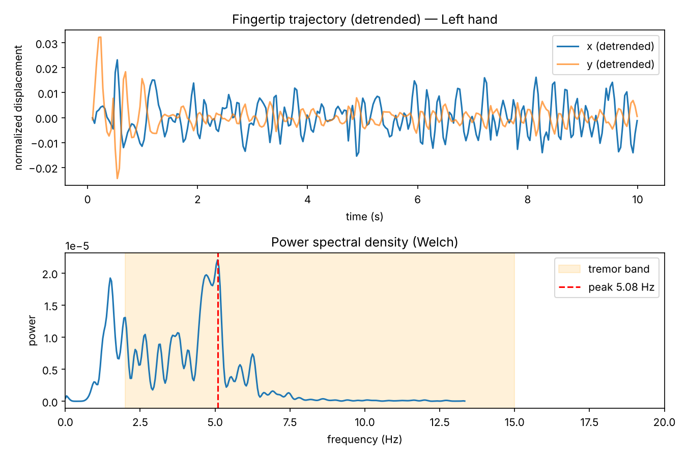
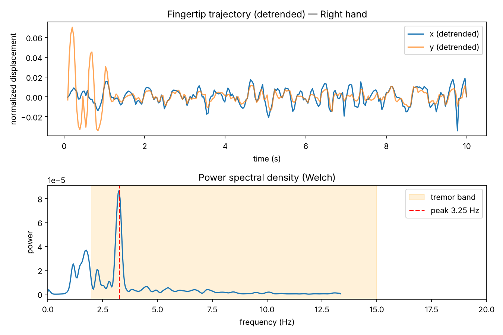
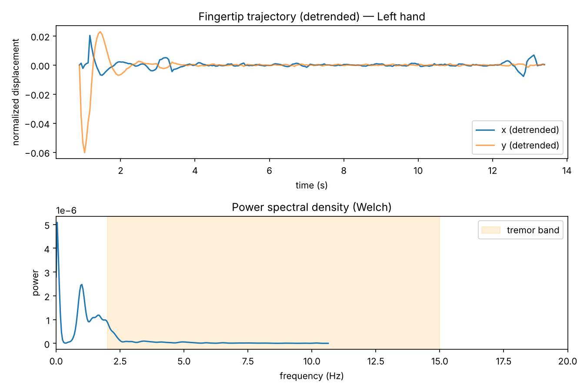
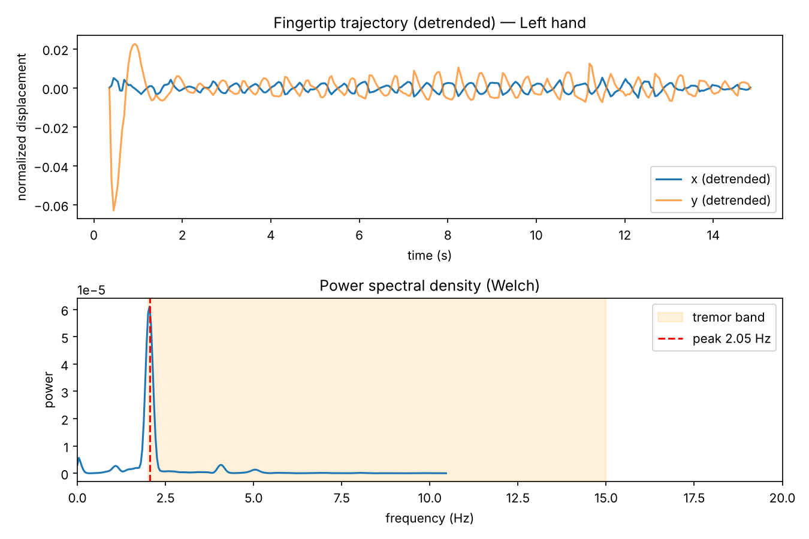
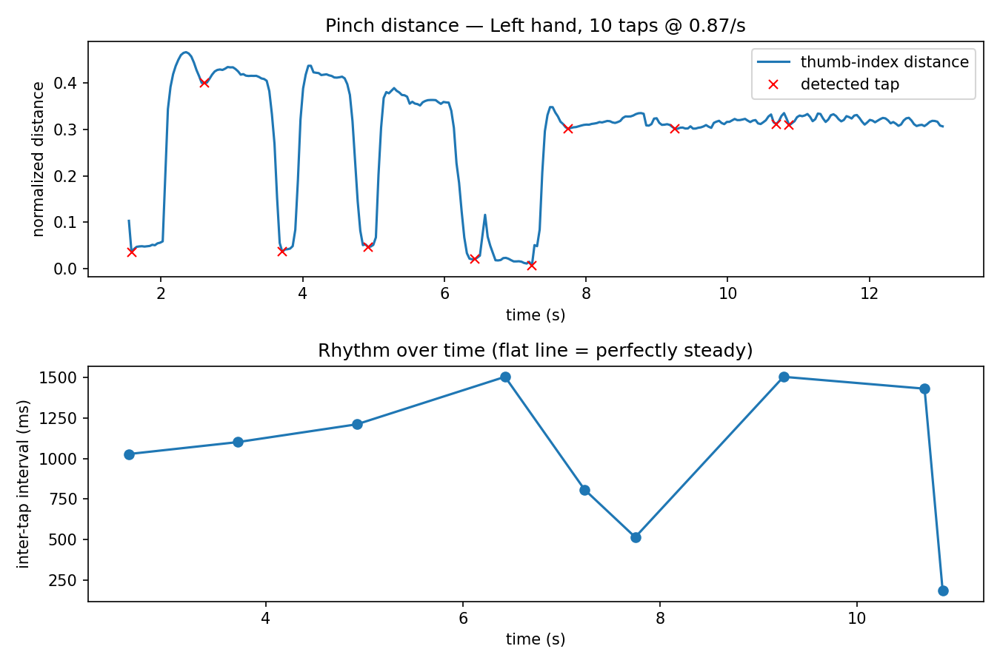
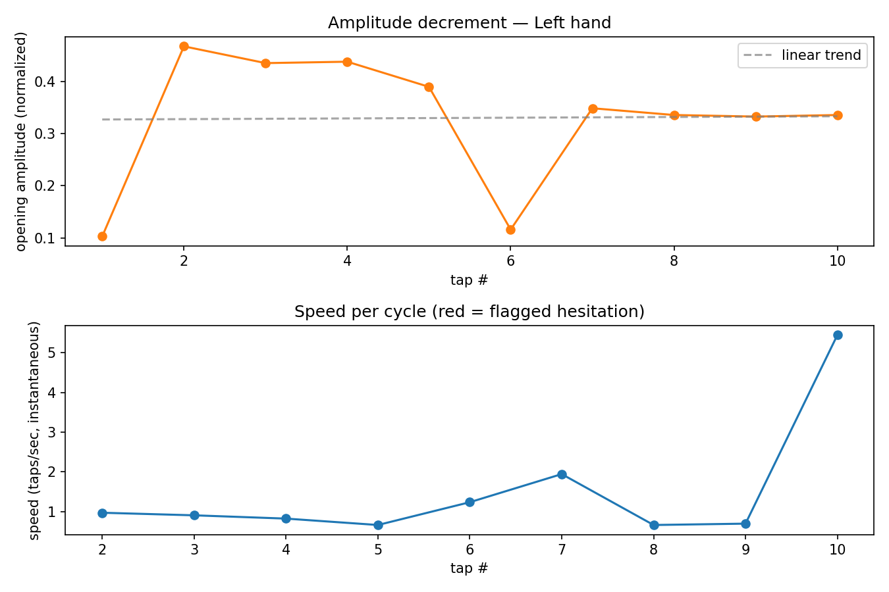
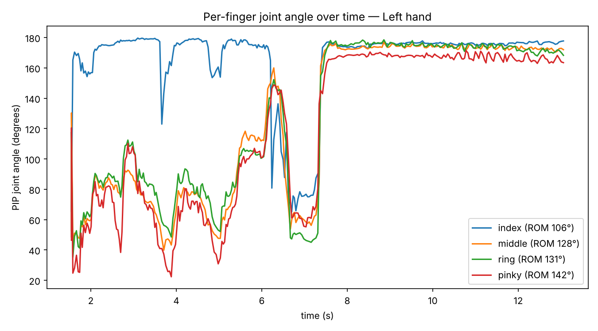

# BioMotion — webcam-based quantitative motor assessment using MediaPipe and classical signal processing

**Goal:** can a consumer webcam and MediaPipe recover clinically relevant
motor metrics — tremor frequency, finger-tapping performance, joint range of
motion, and bilateral asymmetry — using only classical signal processing, no
medical dataset, and no trained model?

Tracks up to 2 hands (42 landmarks total) and extracts 5 quantitative motor
metrics in real time from a single consumer webcam.

Unlike most MediaPipe hand-tracking demos, which stop at visualization or
gesture recognition, BioMotion treats the tracked landmarks as time-series
signals and extracts quantitative motor metrics from them (FFT/Welch peak
detection, joint-angle geometry, decrement trend fitting) — the landmarks
are the sensor, not the end product.



| Metric | Clinical relevance |
|---|---|
| Tremor frequency | Tremor characterization in disorders such as Parkinson's disease and essential tremor |
| Finger tap rate | Finger-tapping metrics commonly used in bradykinesia assessment |
| Amplitude/speed decrement | Mirrors the MDS-UPDRS motor exam (item 3.6) methodology |
| Joint ROM | Post-surgical / stroke rehab tracking |
| Bilateral asymmetry | Relevant to hemiparesis and Parkinsonian asymmetry |

> BioMotion demonstrates that clinically relevant motor metrics can be
> extracted from consumer-grade webcams using markerless hand tracking and
> classical signal processing. It is a research prototype for quantitative
> motor assessment, not a diagnostic or screening tool — it has not been
> validated against patient data or a clinical population.

**Design principles:** no training required · no proprietary datasets ·
fully reproducible · runs on commodity hardware · open-source components only.

## What we built

- **`python/`** — capture (both hands, all 21 landmarks/hand) + 5 analysis
  scripts: tremor frequency (FFT/Welch), tap rate & rhythm, amplitude/speed
  decrement (bradykinesia-style), per-finger ROM, bilateral L/R asymmetry.
- **`web/`** — live in-browser version: glowing trail, live frequency
  readout, and a digitized Archimedes spiral-tracing test.

## Demo

<p align="center">
  
</p>

10s clip, both hands tracked live, per-hand frequency readout on screen.
Recorded with `python record_demo.py --seconds 10`, which also auto-saves
the landmark CSV and generates the PSD plot below from that same take:

<p align="center">
  
  
</p>

**Result: Left 5.08 Hz, Right 3.25 Hz** (recomputed offline with the current detector, at the ~27 fps of this take).

## What we did to test it

1. **Tremor frequency**: shook hand in time with a metronome at known BPM,
   compared detected frequency to `BPM/60`. Ran a still-hand baseline too.
2. **Tap decrement**: tapped normally, let amplitude/speed fade — checked
   the decrement slope goes negative when it should.
3. **ROM**: bent fingers through full range, checked angle trace looked right.
4. **Bilateral asymmetry**: shook one hand more than the other, checked the
   asymmetry index responded.

## Results

One recording per condition, index fingertip, peak detector in `tremor_math.py`
(6 s Welch window, 0.17 Hz resolution):

| Target | Detected | Verdict |
|---|---|---|
| still baseline | no peak | correct |
| 2 Hz metronome | 2.05 Hz | matches |
| 3 Hz metronome | 4.97 Hz | ambiguous: a second peak at 3.01 Hz has the same power |
| 5 Hz metronome | 4.98 Hz | matches |

The 3 Hz recording has two near-equal peaks, so it needs repeating before it can
be called either way. Sampling is not the limit here: at ~21 fps the Nyquist
frequency is ~10 Hz, and synthetic sine waves at 2-9 Hz, sampled on this
recording's real frame timestamps, were recovered within 0.05 Hz. What limits
detection is how much of the hand's motion falls in the band compared with
slower arm movement.

An earlier version used a 2 s window and measured peak prominence against the
whole spectrum, so 1-2 Hz arm motion hid the 5 Hz peak. That was misread at the
time as a frame-rate limit, and is fixed.

<table>
<tr>
<td></td>
<td></td>
</tr>
</table>

Found and fixed two real bugs during validation: naive peak-search was
reporting the search band's edge as a "peak" for a stationary hand (fixed
with `scipy.signal.find_peaks` + prominence threshold); slow arm drift was
swamping real tremor peaks (fixed with a high-pass filter). Both in
`tremor_math.py`.

Tap / decrement / ROM also run cleanly on real recordings:

<p align="center">



</p>

10 taps @ 0.87/s, rhythm CV 0.42 · amplitude trend +1.9% (no decrement).

ROM uses MediaPipe's 3D landmarks and the 2nd-98th percentile of the PIP angle. On this
tapping recording it reads 106-142° across fingers, close to or above the ~100-110° a PIP
joint moves. MediaPipe's depth is an estimate and this take was not a ROM task, so treat it
as unvalidated until checked against a protractor. An earlier 2D version reported 176-178°,
which is physically impossible and came from the hand rotating in view.

## Setup

```
cd python
pip install -r requirements.txt
curl -L -o models/hand_landmarker.task https://storage.googleapis.com/mediapipe-models/hand_landmarker/hand_landmarker/float16/1/hand_landmarker.task
```

## Usage

```
python capture.py --session name        # r=record  c=clear trail  q=quit
python analyze_tremor.py ../data/name.csv
python analyze_taps.py ../data/name.csv
python analyze_decrement.py ../data/name.csv
python analyze_rom.py ../data/name.csv
python analyze_asymmetry.py ../data/name.csv   # needs both hands in the clip
python record_demo.py --seconds 10       # hands-free demo recorder
python analyze_reliability.py --target-hz 2.0 ../data/2hz_trial*.csv  # aggregate repeated trials
```

All analysis scripts take `--hand Left`/`--hand Right` (default: whichever
hand has more rows).

Web demo: `cd web && python -m http.server 8000`, open `localhost:8000`.

## Data schema

One row per hand per frame: `frame, t_sec, hand, handedness_score, lm0_x, lm0_y, lm0_z, ... lm20_x, lm20_y, lm20_z`
(standard MediaPipe landmark indexing — see `landmarks.py`).

## Limitations

- Validated only on a healthy participant (self-recorded), not a clinical population.
- Accuracy depends on webcam frame rate and lighting; tested at ~20-21fps.
- At ~21 fps the Nyquist frequency is ~10.5 Hz, so tremor above about 9 Hz cannot
  be measured. Timing jitter and motion blur near that limit are untested on
  real tremor.
- One recording per frequency: no repeatability data yet.
- ROM is not yet validated against a protractor or goniometer (see Results).
- Not yet cross-validated against a second sensor (IMU, optical motion
  capture) or a clinician-rated assessment — metronome/protractor checks are
  a methods sanity check, not clinical validation.

## Future work

- Compare against a wearable IMU or optical motion capture on the same task,
  for an independent accuracy check beyond a metronome/protractor.
- Higher-frame-rate capture (phone camera, 60-120fps) to reduce motion blur and
  extend the measurable band.
- Inter-finger independence during tapping (spasticity/coordination marker).
- Grip aperture over time (reach-to-grasp kinematics).
- Port the web spiral test into Python for offline scoring.

Robustness questions not yet tested, with a concrete protocol for each
(`analyze_reliability.py` aggregates the results once trials exist):
- **Test-retest reliability**: record the same task on separate days, check
  whether the detected metric stays stable.
- **Cross-device agreement**: same task on a laptop webcam, phone webcam,
  and USB webcam, compare detected values.
- **Lighting robustness**: same task in a bright room, dim room, and
  backlit, check for accuracy degradation.
- **Distance robustness**: same task at ~50cm, 1m, and 2m from the camera.
